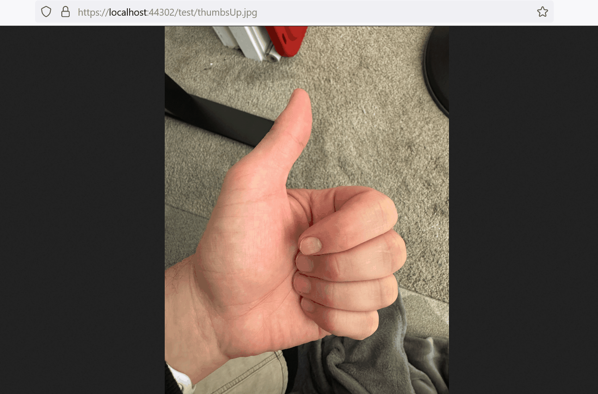
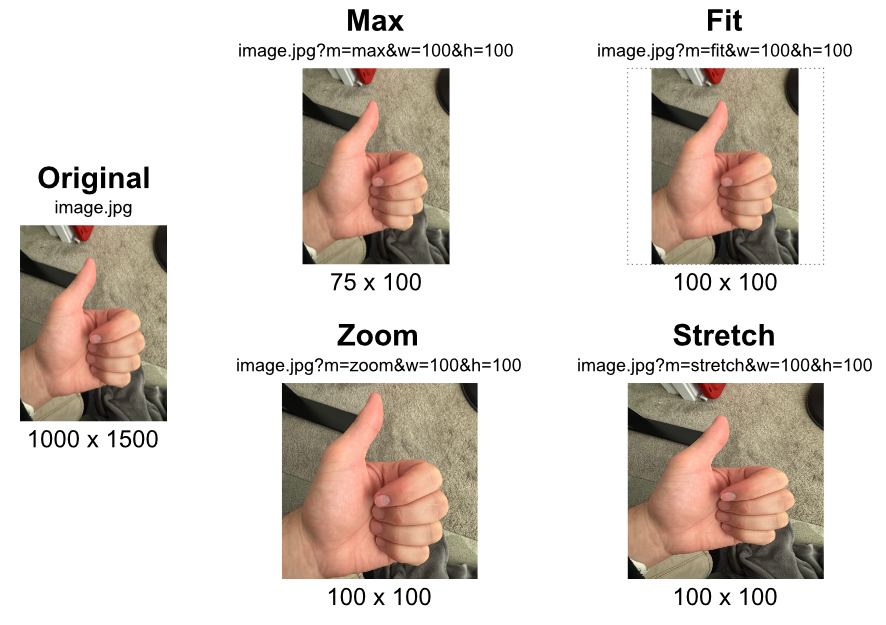
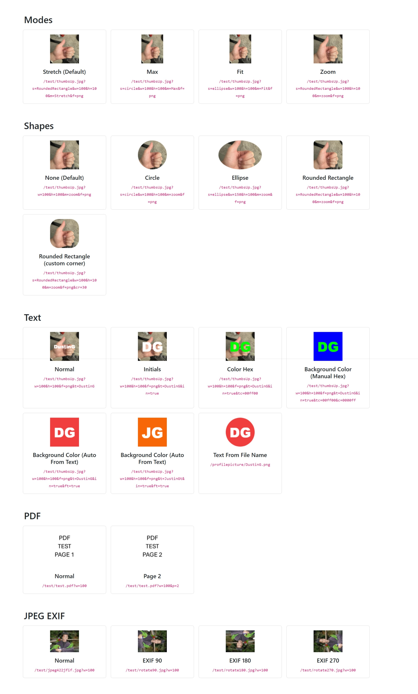
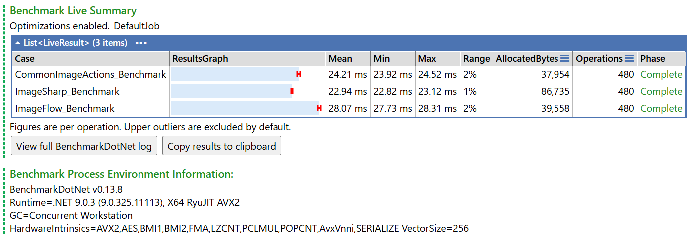
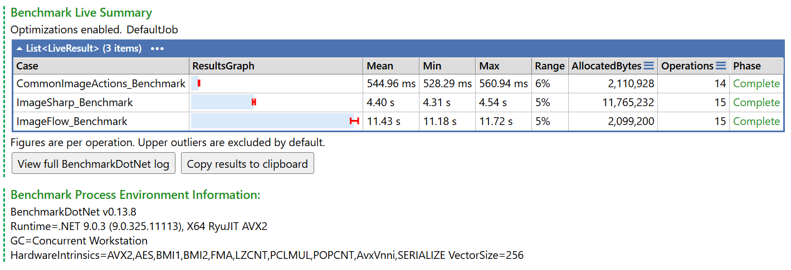

# Common Image Actions


[](https://www.nuget.org/packages/CommonImageActions.AspNetCore)


## Summary
A tuned image conversion library to add common image actions like resize and mask to your .Net 
and Asp.net core projects. This library is highly performant both in execution time and in memory use since it
extends Microsoft libraries. This library should continue to increase in performance as Microsoft further
improves their libraries.



## Features
✅ Resize images\
✅ Convert images to be circle or rounded rectangle\
✅ PDF support\
✅ Fast and memory efficient\
✅ Create user profile placeholders where background auto changes based on name

\
✅ Resize through url in asp.net core (`.jpg?w=50&m=zoom`) \
✅ Crop, rotate and flip, with control over which part of the image is kept \
✅ Filters: blur, sharpen, brightness, contrast, saturation, sepia, invert, pixelate, vignette \
✅ Watermarks and text with your own fonts \
✅ Browser caching (ETag and 304 responses), disk cache limits and signed urls in asp.net core \
✅ Works with any project that supports .net standard \
✅ Fluent interface


## Getting Started (Asp.Net Core)
#### Install the NuGet Package
```bash
    Install-Package CommonImageActions.AspNetCore
```


#### Add UseCommonImageActions Middleware
Add the middleware to your startup file. Make sure that it is above `app.UseStaticFiles()`. You can watch a specific directory by setting the `PathToWatch` property in the `CommonImageActionSettings` object.
```csharp
app.UseCommonImageActions(
    new CommonImageActionSettings()
    {
        PathToWatch = "/test",
    }
);
```


## Getting Started
#### Install the NuGet Package
```bash
    Install-Package CommonImageActions.Core
```

#### Pass image bytes to the ImageProcessor.Process
Get the image `bytes[]` and pass those bytes to the `ImageProcessor.Process` function
```csharp
byte[] testJpg = File.ReadAllBytes("test.jpg");
var result = await ImageProcessor.Process(testJpg)
               .Width(100)
               .Height(100)
               .Mode(ImageMode.Zoom)
               .Shape(ImageShape.Circle)
               .ToImageAsync();
```


 ## Code Examples (Asp.net core)

 #### Watch all images in all directories
```csharp
app.UseCommonImageActions()
```

#### Set all images to be 50x50 png images for the /logos directory
```csharp
app.UseCommonImageActions(
    new CommonImageActionSettings()
    {
        PathToWatch = "/logos",
        DefaultImageActions = new CommonImageActions.Core.ImageActions()
        {
            Height = 50,
            Width = 50,
            Format = SkiaSharp.SKEncodedImageFormat.Png
        }
    }
);
```

#### Generate user icons
```csharp
//the ChooseImageColorFromTextValue ensures that the following will have a different background color
//https://localhost:44302/profilepicture/profile.png?t=DustinGa
//https://localhost:44302/profilepicture/profile.png?t=DustinG
//https://localhost:44302/profilepicture/DustinGam.png
app.UseCommonImageActions(
    new CommonImageActionSettings()
    {
        PathToWatch = "/user/icons/",
        UseFileNameAsText = true,
        IsVirtual = true,
        DefaultImageActions = new ImageActions()
        {
            Height = 192,
            Width = 192,
            Format = SkiaSharp.SKEncodedImageFormat.Png,
            Shape = ImageShape.Circle,
            AsInitials = true,
            ChooseImageColorFromTextValue = true,
            Mode = ImageMode.Max
        }
    }
);
```

#### Add to Asp.net Core and route to an external blob storage
Like AzureBlob or Amazon S3 or any other remote server
```csharp
app.UseCommonImageActions(
    new CommonImageActionSettings()
    {
        PathToWatch = "/remote",
        RemoteFileServerUrl = "https://dustingamester.com/img/"
    }
);
```

#### Let browsers cache images, and limit the disk cache
Every image is sent with an `ETag`, so a browser that already has it is answered with an empty `304 Not Modified`. Set `BrowserCacheMaxAge` to also let browsers and CDNs reuse an image without asking.
```csharp
app.UseCommonImageActions(
    new CommonImageActionSettings()
    {
        PathToWatch = "/photos",
        BrowserCacheMaxAge = TimeSpan.FromDays(7),
        UseDiskCache = true,
        DiskCacheMaxAge = TimeSpan.FromDays(30),
        DiskCacheMaxSizeBytes = 500 * 1024 * 1024
    }
);
```

#### Only process urls that your site created
With a `SigningKey` set, a url with a query string is refused (403) unless it ends with a signature made from the same key. This stops other people from asking your server for images in any size they like.
```csharp
app.UseCommonImageActions(
    new CommonImageActionSettings()
    {
        PathToWatch = "/photos",
        SigningKey = builder.Configuration["ImageSigningKey"]
    }
);

//wherever an image url is written, for example in a razor view
//   /photos/cat.jpg?w=200  ->  /photos/cat.jpg?w=200&sig=5f2c...
var url = CommonImageActionsUrlSigner.SignUrl("/photos/cat.jpg?w=200", signingKey);
```

#### Add a watermark to every image in a directory
```csharp
app.UseCommonImageActions(
    new CommonImageActionSettings()
    {
        PathToWatch = "/photos",
        DefaultImageActions = new ImageActions()
        {
            WatermarkImage = File.ReadAllBytes("logo.png"),
            WatermarkAnchor = ImageAnchor.BottomRight,
            WatermarkOpacity = 0.8
        }
    }
);
```

#### Check or change what a request is about to do
```csharp
app.UseCommonImageActions(
    new CommonImageActionSettings()
    {
        PathToWatch = "/photos",
        OnActionsParsed = (context, actions) =>
        {
            //never make anything wider than 1000 pixels, whatever the url asks for
            if (actions.Width > 1000)
            {
                actions.Width = 1000;
            }
            return Task.CompletedTask;
        },
        OnPrepareResponse = context => context.Response.Headers["X-Robots-Tag"] = "noindex"
    }
);
```

#### Register settings with dependency injection
Settings can be registered in the service collection (or bound from configuration) instead of being passed to `UseCommonImageActions`.
```csharp
builder.Services.AddCommonImageActions(settings =>
{
    settings.PathToWatch = "/photos";
    settings.UseDiskCache = true;
});

app.UseCommonImageActions();
```

 ## Code Examples
 #### Crop, rotate and filter an image
 ```csharp
 byte[] testJpg = File.ReadAllBytes("test.jpg");
 var result = await ImageProcessor.Process(testJpg)
                .Crop(100, 100, 800, 600)
                .Rotate(90)
                .Width(400)
                .Brightness(1.1)
                .Sharpen()
                .Quality(80)
                .ToImageAsync();
```

 #### Zoom in on the part of the image that matters
 ```csharp
 //keep the top of the image when it is cropped to a square, and never enlarge a small image
 var result = await ImageProcessor.Process(testJpg)
                .Width(300)
                .Height(300)
                .Mode(ImageMode.Zoom)
                .Anchor(ImageAnchor.Top)
                .AllowUpscale(false)
                .ToImageAsync();
```

 #### Add a watermark and a caption
 ```csharp
 //a font file can be used without installing it on the machine
 ImageProcessor.RegisterFont("Brand", "fonts/brand.ttf");

 var result = await ImageProcessor.Process(testJpg)
                .Width(800)
                .Watermark(File.ReadAllBytes("logo.png"), ImageAnchor.BottomRight, opacity: 0.8)
                .Text("Summer 2025")
                .FontFamily("Brand")
                .FontSize(32)
                .TextAnchor(ImageAnchor.BottomLeft)
                .ToImageAsync();
```

 #### Read the size of an image without decoding it
 ```csharp
 var details = ImageProcessor.Identify(testJpg);
 Console.WriteLine($"{details.Width}x{details.Height} {details.Format}");
```

 #### Process an image using the fluent API
 ```csharp
 byte[] testJpg = File.ReadAllBytes("test.jpg");
 var result = await ImageProcessor.Process(testJpg)
                .Width(100)
                .Height(100)
                .Mode(ImageMode.Zoom)
                .Shape(ImageShape.Circle)
                .ToImageAsync();
```

 #### Process a pdf using the fluent API
 ```csharp
 byte[] testPdf = File.ReadAllBytes("test.pdf");
 var result = await PdfProcessor.Process(testPdf)
                .Width(100)
                .Height(100)
                .Mode(ImageMode.Zoom)
                .Shape(ImageShape.Circle)
                .ToImageAsync();
```

## URL Parameters (Asp.net Core)
| Parameter | Possible Values | Description |
|  ------------- | ------------- | ------------- |
| width, w  | Integer | Set the width of the image |
| height, h | Integer | Set the height of the image |
| gray, g | Boolean | When true set image to grayscale |
| mode, m | Max, Fit, Zoom, Stretch | **Max**: If both width and height are present then the image will be resized to the max of whatever parameter, and the width will scale accordingly. <br> **Fit**: When both width and height are present fit the image into the container without adjusting the ratio.  <br> **Zoom**: When both width and height are present zoom the image in to fill the space. <br> **Stretch** (default): When both width and height are present stretch the image to fit the container. |
| shape, s | Circle, Ellipse, RoundedRectangle  | Mask out the image to be of a certain shape. |
| corner, cr | Integer | The corner radius when shape is RoundedRectangle. Default is 10. |
| text, t | String | The text to display on the image |
| initials, in | Boolean | When true will only display initials of text. For example DustinG is displayed as DG. |
| color, c | String ffccff | Set a color for the image |
| textColor, tc | String ffccff | Set the color of the text |
| colorFromText, ft | Boolean | When true a color will be generated based on a hash of the text. The list of colors can be updated in `ImageProcessor.BackgroundColours`. |
| format, f | Jpeg, Png, Webp | What format to export the resulting image as. Default is the format of the original image. Formats that can be read but not written (for example Gif, Bmp and Ico) are exported as png. |
| quality, q | Integer 1 to 100 | Encoding quality for jpeg and webp. Default is 90 for jpeg (`ImageProcessor.JpegQuality`) and lossless for webp. |
| anchor, a | Center, Top, Bottom, Left, Right, TopLeft, TopRight, BottomLeft, BottomRight | Which part of the image Zoom keeps when it crops, and where the image sits in Fit. Default is Center. |
| focalX, fx <br> focalY, fy | Number 0 to 1 | The point of interest in the image (0,0 is the top left, 1,1 is the bottom right). Zoom keeps this point as close to the middle as it can. Takes priority over anchor. |
| crop | x,y,width,height | Use only this part of the original image, in pixels. Applied before rotating and resizing. |
| upscale, u | Boolean | When false an image is never made larger than its original size. Default is true. |
| resampler, rs | Nearest, Bilinear, Mipmap, Bicubic | How pixels are calculated when resizing. Default is Bicubic. |
| rotate, r | Number | Degrees to rotate clockwise. Any angle can be used, the image is made large enough to hold it. |
| flip, fl | h, v, both | Mirror the image horizontally, vertically or both. Applied before rotating. |
| background, bg | String ffccff | Colour painted behind the image. Fills the space left by Fit, shapes, rotation and transparency (which is black in a jpeg otherwise). |
| blur, bl | Number 0 to 100 | Blur radius in pixels |
| sharpen, sh | Number 0 to 10 | Sharpening strength. 1 is a moderate sharpen. |
| brightness, br | Number 0 to 10 | 1 is unchanged, lower is darker, higher is brighter |
| contrast, co | Number 0 to 10 | 1 is unchanged, lower is flatter, higher has more contrast |
| saturation, sa | Number 0 to 10 | 1 is unchanged, 0 is grayscale, higher is more vivid |
| sepia, se | Boolean | When true give the image a warm brown tone |
| invert, inv | Boolean | When true invert the colours |
| pixelate, px | Integer | Size in pixels of the blocks to break the image into |
| vignette, v | Number 0 to 1 | Darken the corners. 1 is black corners. |
| font, fn | String | Font for the text. An installed font, or a name registered with `ImageProcessor.RegisterFont`. Default is Arial. |
| fontSize, fs | Integer | Text size in pixels. Default is to size the text to fill the image. |
| textAnchor, ta | Center, Top, Bottom, Left, Right, TopLeft, TopRight, BottomLeft, BottomRight | Where the text is placed. Default is Center. |
| wrap, tw | Boolean | When true, and a fontSize is set, text that is too wide wraps onto more lines |
| metadata, md | Boolean | When true keep the exif, xmp and iptc metadata of the original. Jpeg to jpeg only. Default is to remove it. |
| sig | String | Signature of the url, needed when a `SigningKey` is set. Always the last parameter. |
| password, pw | String | (pdf only) password to open pdf |
| page, p  | Integer | (pdf only) what page to render. First page is 1.|

A watermark is an image rather than a value, so it is set in code with `ImageActions.WatermarkImage` (see the examples above) and not through the url.

#### Modes Visualized



## CommonImageActionSettings (Asp.net Core)
| Setting | Description |
|  ------------- | ------------- |
| PathToWatch  | What path to watch. For example `/test` will watch for images in the test directory |
| IsVirtual  | Avoid looking up the image and construct the image virtually (useful for profile pictures) |
| RemoteFileServerUrl  | The URL of the remote resource to pull images from. Often a blob storage like Amazon S3 or Azure Blob |
| UseDiskCache | When true the system will save and return cached images. This can dramatically improve performance. |
| DiskCacheLocation | Where to store and retrieve the DiskCache images from. This directory needs to be writable. If it is not the system will print errors to the console, but will still continue to run. |
| DiskCacheMaxAge | How long a cached image is used before it is made again. Default is forever. A cached image is also made again when the original file changes. |
| DiskCacheMaxSizeBytes | The most disk space the cache may use. When it grows past this the oldest files are deleted. Default is no limit. |
| BrowserCacheMaxAge | How long a browser or CDN may reuse an image without asking again (`Cache-Control: max-age`). Default is not set, browsers then check back each time and get a `304 Not Modified` when nothing changed. |
| SigningKey | When set, a url with a query string is only processed if it ends with a valid signature. Create signed urls with `CommonImageActionsUrlSigner.SignUrl`. |
| OnActionsParsed | Called with the image actions that were read from the url, before they are used. They can be changed here. |
| OnPrepareResponse | Called just before an image is sent, to add or change response headers. |
| DefaultImageActions | Set a default image action to be used on all requests against a particular path. Useful when you want all images in a directory to be a specific dimension. |
| UseFileNameAsText | Use the filename to set the text value. For example `Dustin_Test.png` would be the same as `image.png?t=Dustin_Test`. A text value in the url takes priority over the filename. |

## Sample Page


## Benchmarking
Use [BenchmarkDotNet](https://github.com/dotnet/BenchmarkDotNet) to compare the performance between 
[Common Image Actions](https://github.com/dustout/CommonImageActions), 
[ImageSharp](https://github.com/SixLabors/ImageSharp), and 
[ImageFlowDotNet](https://github.com/imazen/imageflow-dotnet).
The benchmark files can be found in the /Benchmark directory if you wish to run the same test. 

#### Single Image
When converting a single image we can see the AllocatedBytes is half of ImageSharp, and the performance is faster than
ImageFlow. \


#### Multiple Images
When converting multiple images we can see where CommonImageActions really shines. What takes 547ms in CommonImageActions
takes 4,400ms in ImageSharp and 11,430ms in ImageFlow. We can also see that the allocated memory 
is significantly less than ImageSharp. \

